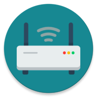
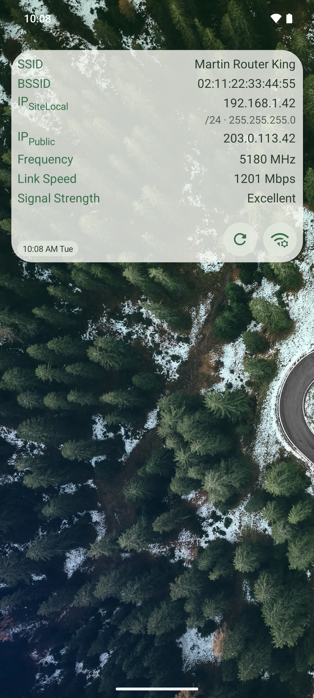
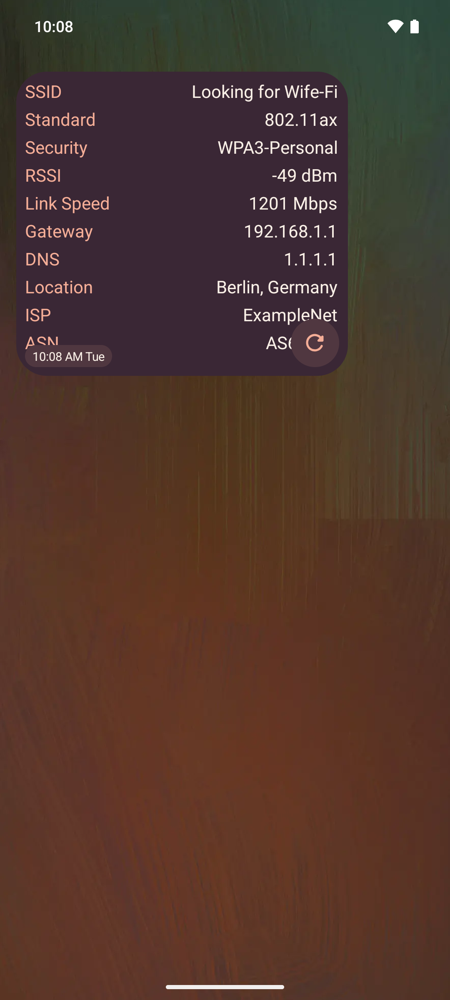
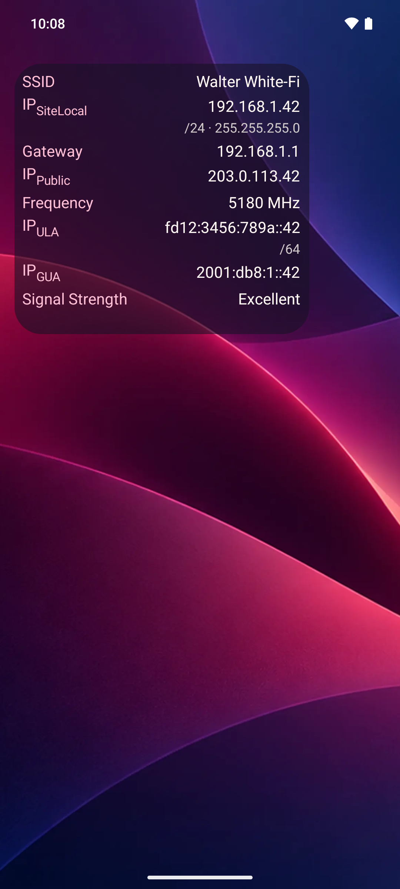
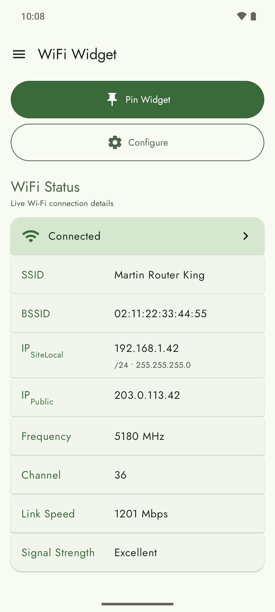
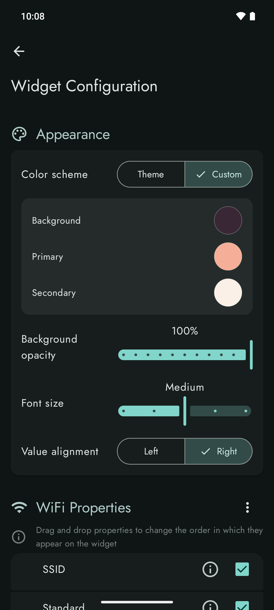
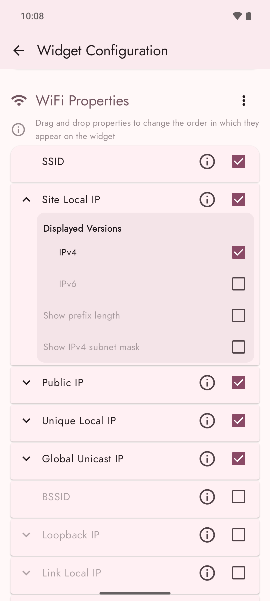
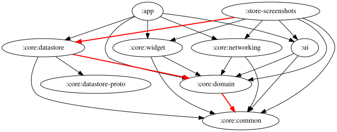

  

<h1 align="center">WiFi Widget</h1>

  A customizable Android widget for monitoring your Wi-Fi connection details at a glance.

  
  
  
  

   

  
  
  

## Screenshots

|  |  |  |
|-----------------------------------------------------------------------------------------------------------------------------------------------|-----------------------------------------------------------------------------------------------------------------------------------------|------------------------------------------------------------------------------------------------------------------------------------------|
|                 |     |      |

## Download

    
  
  
  

## Features

- **Wi-Fi information at a glance:** View connection status and details in the app or directly on your home screen.
- **Flexible property selection:** Choose which information to display, configure its presentation, and rearrange properties to suit your needs.
- **Customizable widget appearance:** Adjust light/dark mode, dynamic or custom colors, background opacity, font size, and value alignment. Resize the widget using your launcher.
- **Local and internet-derived network details:** Inspect IP addresses, network configuration, public IP, approximate IP-based location, ISP, and ASN.
- **Quick interactions:** Tap property rows to copy values, refresh the widget manually, or open Android's Wi-Fi settings.
- **Automatic updates:** Optionally schedule periodic widget refreshes at intervals from 15 minutes to 24 hours, subject to Android's background-execution limits.
- **Modern in-app UI:** Material expressive styling, configurable light and dark themes, and adaptive portrait and landscape layouts.

### Supported properties

| Category                      | Properties                                                                                                              |
|-------------------------------|-------------------------------------------------------------------------------------------------------------------------|
| **Connection**                | SSID, BSSID, frequency, channel, link speed, RSSI, signal strength, Wi-Fi standard, Wi-Fi generation, security protocol |
| **IP addresses**              | Loopback, site-local, link-local, unique-local, multicast, global-unicast, public IP                                    |
| **Network configuration**     | Gateway, DNS, DHCP, NAT64 prefix                                                                                        |
| **IP-based location**         | Postal code, district, city, region, country, continent, coordinates                                                    |
| **Other network information** | ISP, ASN                                                                                                                |

IP address properties support IPv4 and/or IPv6 where applicable, with configurable prefix-length and subnet-mask presentation. Public IP addresses are obtained through [ipify](https://www.ipify.org/); IP-based location, ISP, and ASN information come from [ip-api.com](https://ip-api.com/). Availability depends on your connection, Android's permissions and restrictions, and the remote services.

## Getting started

1. Install **WiFi Widget** from one of the sources above.
2. Add **WiFi Widget** from your Android launcher's widget picker, or via a respective button inside the app to your home screen.
3. Open the app to select, arrange, and configure the displayed properties and customize the widget's appearance.
4. Grant location access only if you want to display properties that require it, such as SSID or BSSID.

You can also view your current Wi-Fi information directly in the app without adding a widget.

## FAQ

### Why is location access needed to show the SSID or BSSID?

An SSID identifies a Wi-Fi network, and a BSSID identifies an access point. These identifiers can be used to estimate a device's physical location, so [Android treats them as location-sensitive information](https://developer.android.com/about/versions/pie/android-9.0-changes-all). Reading them requires location permission and, on supported Android versions, device location services to be on. Keeping them updated from a widget while the app is not open may also require **Allow all the time** location access. You can disable these properties and use the rest of the app without granting it.

### Why don't properties always refresh as soon as the network changes in the background?

WiFi Widget listens for network changes while its process is running and can update the widget then. Android may stop that process in the background, which ends those callbacks; [manifest-registered connectivity broadcasts cannot restart it](https://developer.android.com/develop/background-work/background-tasks/bg-work-restrictions). A scheduled refresh or a tap on the widget's refresh button can update the properties later, but Android's background restrictions can delay scheduled work. For this reason, the app cannot guarantee an immediate refresh for every network change.

### Why is 15 minutes the shortest automatic refresh interval?

Automatic refresh uses Jetpack WorkManager, whose [periodic work has a minimum repeat interval of 15 minutes](https://developer.android.com/develop/background-work/background-tasks/persistent/getting-started/define-work). This is the shortest interval the app can request, not a promise that every refresh will happen exactly 15 minutes apart: Android can defer runs to save power.

### Why does the widget sometimes show “Restricted by Battery Saver”?

Android's Battery Saver can restrict access to network information or background network requests. When Battery Saver is enabled and required network details are unavailable, WiFi Widget may display **Restricted by Battery Saver** instead of an affected property value. This is a possible explanation for the missing information, not proof that Battery Saver caused it. Values that remain accessible can still be displayed.

## Privacy & permissions

WiFi Widget uses Android's location permission for location-sensitive Wi-Fi identifiers, such as SSID and BSSID. You do not need to grant it to use properties that don't require it.

If you enable internet-derived properties, the app contacts external services: [ipify](https://www.ipify.org/) for public IP addresses and [ip-api.com](https://ip-api.com/) for IP-based location and network information. These lookups are based on your internet-facing IP address, not GPS coordinates; IP-based locations are approximate. The current ip-api.com integration uses unencrypted HTTP, while ipify requests use HTTPS.

## For developers

### Project Structure

| Module                      | Responsibility                                                                                                 |
|-----------------------------|----------------------------------------------------------------------------------------------------------------|
| `:app`                      | Application entry point, manifest configuration, dependency injection setup, and release configuration.        |
| `:ui`                       | Jetpack Compose screens, navigation, UI state management, and foreground Wi-Fi synchronization.                |
| `:core:domain`              | Domain models, repository interfaces, configuration models, and Wi-Fi property presentation logic.             |
| `:core:networking`          | Wi-Fi and connectivity monitoring, local property resolution, remote API requests, and network-scoped caching. |
| `:core:widget`              | Home screen widget rendering, interactions, network observation, and WorkManager-based refreshing.             |
| `:core:datastore`           | Persistence and retrieval of widget configuration and preferences using DataStore.                             |
| `:core:datastore-proto`     | Protocol Buffer schemas and generated types for persisted configuration.                                       |
| `:core:common`              | Shared utilities, logging, and dependency injection infrastructure.                                            |
| `:core:resources`           | Shared Android resources, including strings, colors, and drawables.                                            |
| `:benchmarking`             | Macrobenchmarks and baseline profile generation for performance optimization.                                  |
| `:store-screenshots`        | Automated Play Store screenshot generation for phones and tablets.                                             |
| `:testing:launcher`         | Shared UI testing utilities for interacting with Launcher3 and home screen widgets.                            |
| `:widget-integration-tests` | Instrumented integration tests covering widget behavior, refreshing, and recovery.                             |

### Module graph

For a detailed explanation of how the home screen and widget obtain, cache, validate, and refresh properties, see [Property refresh and synchronization](docs/property-refresh-and-synchronization.md).

### Tech stack

| Area                 | Technologies                                                       |
|----------------------|--------------------------------------------------------------------|
| Language             | Kotlin                                                             |
| In-app UI            | Jetpack Compose, Material 3                                        |
| Widget UI            | Jetpack Glance, Android RemoteViews (subscript labels)             |
| Navigation           | Jetpack Navigation 3                                               |
| Dependency injection | Dagger Hilt                                                        |
| Asynchronous work    | Kotlin coroutines, Flow, WorkManager                               |
| Networking           | OkHttp, kotlinx.serialization                                      |
| Persistence          | DataStore (Proto and Preferences)                                  |
| Testing              | JUnit, MockK, Robolectric, Turbine, Compose UI tests, UI Automator |
| Performance          | Macrobenchmark, Baseline Profiles                                  |

## Contributing

Whether you've found a bug, have a feature suggestion, or want to improve the code, feel free to open an issue or submit a pull request.
When contributing code, please follow these guidelines:
- Discuss significant changes first: Open an issue before implementing major features.
- Follow existing conventions: Keep changes focused and consistent with the project's architecture and coding style.
- Tests: Ensure relevant tests pass and add or update tests when introducing or changing functionality.
- Formatting: Ensure code passes the project's ktlint checks (./gradlew ktlintCheck).
- Commit messages: Follow the Conventional Commits specification (e.g., feat: add new property, fix: resolve widget refresh issue, docs: update README).
- Documentation: Update relevant documentation when introducing or changing functionality.

Pull requests should clearly describe the changes and their motivation.

## Support the project

If you find WiFi Widget useful and would like to support its development:

## Credits

Logo artwork based on the [Router WiFi Internet Hotspot icon](https://freeicons.io/computer-devices-3/router-wifi-internet-hotspot-icon-487667) by [Hilmy Abiyyu Asad](https://freeicons.io/profile/75801), licensed under [CC BY 3.0](https://creativecommons.org/licenses/by/3.0/). Adapted and animated for WiFi Widget.

## License

WiFi Widget is licensed under the [GNU General Public License v3.0](LICENSE). © [w2sv](https://github.com/w2sv), 2022–present.
