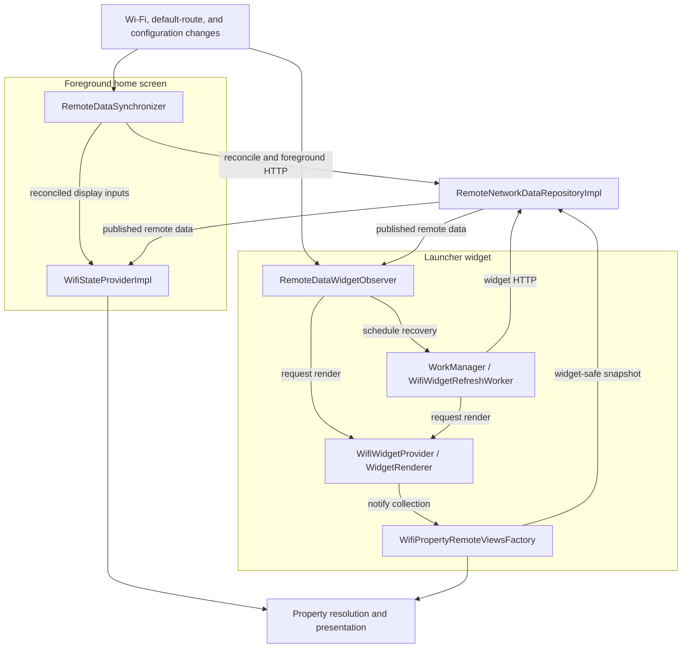

# Property refresh and synchronization

WiFi Widget presents information from Android's Wi-Fi APIs alongside values obtained from internet services. The home screen and launcher widget share the same property-resolution and remote-data infrastructure, but use different mechanisms to keep their displays up to date.

This document explains those mechanisms, the consistency rules for remote data, and the limitations imposed by Android. It describes the current implementation, **not a guarantee of when Android will execute background work**.

## Core concepts

| Operation          | Meaning                                                                                                                                    |
|--------------------|--------------------------------------------------------------------------------------------------------------------------------------------|
| **Rendering**      | Builds a presentation from current platform information and applicable cached remote values. It does not perform HTTP requests.            |
| **Refreshing**     | Attempts to retrieve enabled internet-derived data. It may subsequently cause a render, but a render does not necessarily imply a refresh. |
| **Reconciliation** | Re-evaluates cached data against the current network and configuration. It may change what can be displayed without making a request.      |
| **Recovery**       | Attempts to initialize remote-data groups that are still considered incomplete for the current network and configuration.                  |

The app has two categories of property input:

| Data                                                                                                | Source                                            | Lifetime                                                         |
|-----------------------------------------------------------------------------------------------------|---------------------------------------------------|------------------------------------------------------------------|
| Wi-Fi status and local properties, including SSID, link speed, DNS, gateway, and local IP addresses | Android's `WifiManager` and `ConnectivityManager` | Read from a platform snapshot for each property-resolution pass. |
| Public IPv4/IPv6, IP-based location, ISP, and ASN                                                   | `ipify` and `ip-api.com`                          | Held in network-scoped, **in-memory** repository caches.         |

`WidgetConfig` is persisted with DataStore. It defines enabled properties, order, property settings, appearance, and the widget's periodic refresh policy. **Property values are not persisted.** A new app process therefore starts without previously fetched remote values, even when a widget is already installed; subsequent observations, widget callbacks, or work may fetch them again.

## Architecture overview

The home screen reacts within its ViewModel lifetime. The widget can receive updates while the app process is running, but delegates HTTP to WorkManager so it does not depend on a network callback remaining active indefinitely. Both paths use `RemoteNetworkDataRepositoryImpl` and the same property-resolution logic.

The diagram highlights the main data and control paths rather than every Android callback. A widget render can update local property rows without fetching remote data. Remote-data publication can independently initiate a new widget render.

### Component responsibilities

| Area                     | Main components                                                                  | Responsibility                                                                                |
|--------------------------|----------------------------------------------------------------------------------|-----------------------------------------------------------------------------------------------|
| Configuration            | `WidgetConfigScreenViewModel`, `WidgetConfigDataSourceImpl`, `WidgetActionsImpl` | Persist configuration, then apply widget scheduling and rendering side effects.               |
| Platform observations    | `WifiStatusSourceImpl`                                                           | Expose Wi-Fi status and default-egress observations, plus one-time status snapshots.          |
| Foreground orchestration | `RemoteDataSynchronizer`, `WifiStateProviderImpl`                                | Reconcile and refresh remote data, then produce home-screen state.                            |
| Widget observation       | `RemoteDataWidgetObserver`                                                       | React to network and published-data changes while the process is alive.                       |
| Background work          | `WifiWidgetWorkScheduler`, `WifiWidgetRefreshWorker`                             | Schedule and execute immediate, periodic, and recovery refreshes.                             |
| Shared data              | `RemoteNetworkDataRepositoryImpl`                                                | Plan HTTP requests, validate their network context, maintain caches, and publish remote data. |
| Property presentation    | `WifiPropertyResolverImpl`, `WifiPropertyPresentationProvider`                   | Resolve local and remote values and turn them into ordered display rows.                      |
| Widget presentation      | `WifiWidgetProvider`, `WidgetRenderer`, `WifiPropertyRemoteViewsFactory`         | Handle widget events, render the outer `RemoteViews`, and rebuild collection rows.            |

## Foreground home screen

### Observing changes and fetching data

`WifiStatusSourceImpl` exposes cold flows for Wi-Fi status and default-egress changes. Collection registers the relevant Android callbacks; stopping collection releases them. Default egress is observed separately because a VPN or another default route can change while the Wi-Fi connection remains the same.

`RemoteDataSynchronizer` runs for a home ViewModel lifetime. Its event handling follows this sequence:

1. Reconcile the repository against the current remote-data requirements and default route.
2. Publish reconciled Wi-Fi status and configuration inputs for presentation.
3. When warranted, launch or replace a separate HTTP refresh job.

Keeping HTTP in a separate, cancellable job prevents slow requests from blocking later reconciliation. A changed connected status, a default-egress event, or a relevant configuration change can initiate a refresh. Repeated observations with an unchanged Wi-Fi status can still recompute local properties **without repeating HTTP solely because of the duplicate status**. Disconnecting cancels the outstanding foreground refresh job.

On home-screen resume, `recoverOnForeground()` checks whether remote data still needs initialization. If Wi-Fi is connected, it attempts only the requirements that recovery considers outstanding, rather than repeating an unconditional full refresh.

The foreground repository refresh validates the current default HTTP route. Unlike widget-specific refreshes, it does not require the widget's stricter route-eligibility policy.

### Building home-screen state

`WifiStateProviderImpl` combines the synchronizer's reconciled inputs with property configuration, the repository's published remote-data `StateFlow`, and location-access changes. It waits for the relevant remote configuration to be reconciled before displaying the new requirements, avoiding a transient mixture of new settings and old remote data.

`WifiPropertyResolverImpl` collects connection information, DHCP information, and the selected Wi-Fi link's properties once for each resolution pass. `WifiPropertyPresentationProvider` converts the resolved values into rows in the configured order. Properties without a usable value are normally omitted; the home screen does not use the widget's Battery Saver placeholder policy.

## Launcher widget

### Live observations while the process runs

`Application.onCreate()` initializes `RemoteDataWidgetObserver`, including its subscription to published remote-data changes. Its Wi-Fi and default-route callbacks run only while at least one widget is installed: the first widget starts observation, and removal of the last stops it.

A changed Wi-Fi connection or default route may cause a render, reconciliation, and scheduling of recovery if remote data is incomplete and widget HTTP is eligible. These callbacks **do not perform HTTP**. A change in published remote data can also request a render independently of the component that fetched it.

This fast path exists only while the app process is alive. Android may terminate that process; a network change alone cannot be relied upon to restart it.

### Other update entry points

| Trigger                        | Behavior                                                                                                                                                              |
|--------------------------------|-----------------------------------------------------------------------------------------------------------------------------------------------------------------------|
| Widget refresh button          | `WidgetActionsImpl` broadcasts a refresh request; `WifiWidgetProvider` schedules immediate WorkManager work.                                                          |
| Applied configuration          | Persist first, request a render, update periodic scheduling if refresh settings changed, and request an immediate refresh only when remote-data requirements changed. |
| Periodic interval              | WorkManager schedules a new opportunity to refresh; it is not an exact timer.                                                                                         |
| Android widget update callback | `WifiWidgetProvider.onUpdate()` reconciles remote data, may schedule recovery, and renders the affected widget instances.                                             |
| Collection-factory creation    | `WifiPropertyRemoteViewsFactory.onCreate()` independently reconciles and may schedule recovery before rebuilding its rows.                                            |
| Published remote-data change   | The application-scoped observer requests a widget render while widgets are installed.                                                                                 |

`onUpdate()` may be called when a widget is added, after a reboot, or upon restoration. **An app process restart alone does not invoke `onUpdate()`.** The collection factory has its own recovery check because Android can recreate the collection without recreating the outer widget.

Android's `updatePeriodMillis` is set to `0`: periodic refreshes use WorkManager, not the platform widget-update timer.

### Scheduling and worker execution

`WifiWidgetWorkScheduler` manages three kinds of work:

| Work          | Scheduling                                                                                                           | Execution policy                                                                                                        |
|---------------|----------------------------------------------------------------------------------------------------------------------|-------------------------------------------------------------------------------------------------------------------------|
| **Immediate** | Unique, replaceable one-time work; requests expedited execution with ordinary-work fallback if quota is unavailable. | When interactive, attempt a normal remote refresh if widget-eligible, then render even if no HTTP request was possible. |
| **Periodic**  | Unique periodic work with an initial delay of one configured interval.                                               | Same ordinary refresh-and-render behavior when interactive.                                                             |
| **Recovery**  | Deduplicated one-time work with a connected-network constraint and exponential retry backoff.                        | Attempt only recovery-outstanding data; retry when eligibility or completion conditions are not met.                    |

WorkManager's [minimum periodic interval is 15 minutes](https://developer.android.com/develop/background-work/background-tasks/persistent/getting-started/define-work), but actual execution can be delayed by system scheduling and power-management policies. The recovery work's `CONNECTED` constraint does **not** prove that Wi-Fi is connected or that the default HTTP route is suitable; the worker and repository check those separately.

`WifiWidgetRefreshWorker` also checks `PowerManager.isInteractive`. When the device is noninteractive, immediate and periodic work complete **without fetching or rendering**; recovery work instead requests a retry. When interactive, ordinary work renders even if remote fetching is skipped or unsuccessful, allowing local values to be updated.

Recovery work renders if it changed published remote data, including on completion or cancellation, without relying solely on the application-scoped observer. If nothing new is published, recovery does not need to force a render. The scheduler applies the periodic policy when the first widget is added or relevant settings change, and cancels periodic and recovery work when the last widget is removed.

### Rendering the widget

`WidgetActionsImpl` distinguishes refresh requests from render-only requests. `WifiWidgetProvider` handles a render request directly rather than routing it through `onUpdate()`, which could re-enqueue recovery unnecessarily.

`WidgetRenderer` reads the current Wi-Fi status, constructs the outer `RemoteViews`, and notifies the connected property collection when its data needs rebuilding. `WifiPropertyRemoteViewsFactory` obtains its rows from `WifiPropertyRenderDataProvider`, using current local information and `RemoteNetworkDataRepositoryImpl.widgetSnapshot()` for eligible cached remote data. Neither rendering nor collection-factory callbacks make HTTP requests.

**The widget's displayed update time is the time its outer view was rendered, not the time of the last successful HTTP refresh.** It may advance even if remote data was not fetched or the request failed. Conversely, rebuilding collection rows alone does not necessarily update that timestamp.

## Remote-data cache and correctness

### Different views of cached data

`RemoteNetworkDataRepositoryImpl` separates retained data from data that can currently be published or displayed:

| Data view                      | Meaning                                                                                                                                                         |
|--------------------------------|-----------------------------------------------------------------------------------------------------------------------------------------------------------------|
| Default-route cache            | Remote values and initialization state associated with the observed default HTTP route. A confirmed route change invalidates that route's current cache.        |
| Wi-Fi cache                    | Last-known values obtained over a verified **direct Wi-Fi** default route, retained separately and associated with its exact Android `Network` identity.        |
| Published `data` (`StateFlow`) | Values exposed only when the current default route has been verified. If route identity or capabilities are unavailable, publication hides the retained values. |
| `widgetSnapshot()`             | Widget-specific view: applicable current-route values, or eligible last-known direct-Wi-Fi values for the **same identifiable, still-connected Wi-Fi network**. |

When a route becomes temporarily unverifiable, the repository can retain values privately without publishing them as current. After a confirmed route change, a previously remembered direct-Wi-Fi cache may be restored for the same network identity, but fresh remote initialization is still due.

A VPN default route is a separate HTTP egress. Values fetched over that VPN are never relabeled as values fetched directly over the underlying Wi-Fi network. However, **if the VPN is the default route and no applicable VPN-derived values are available, the widget can still display its retained direct-Wi-Fi values** while the original Wi-Fi `Network` remains identifiable and connected. Those values describe an earlier Wi-Fi fetch and **must not be interpreted as the VPN's current public IP or location**.

The foreground home screen consumes verified, published default-route data rather than the widget-specific fallback snapshot.

### Request planning and recovery criteria

The repository derives remote requirements from the persisted configuration. IP-based location, coordinates, ISP, and ASN require `ip-api.com`; enabled public IPv4 and IPv6 require their respective `ipify` requests. Disabled data groups are not fetched.

A normal refresh attempts all enabled remote groups. Recovery creates a narrower plan based on which groups have been initialized or attempted. Requests can succeed independently, so a partial failure does not erase successful cached values for the same verified route.

**Recovery completion does not mean every individual property has a value.** Its criteria are group-based:

- **ip-api:** A successful response initializes that data group for the relevant configuration; individual requested fields may still be absent.
- **Public IP:** At least one enabled IP version must have a cached successful result, and every enabled version must have been attempted. For example, IPv4 can succeed and IPv6 can fail without requiring recovery to retry IPv6 indefinitely. If all enabled public-IP requests fail, recovery remains incomplete.

A regular refresh can still try all enabled versions again. Recovery retries are intended to restore usable data, not to guarantee that every configured field is available.

### Validation and concurrency

The repository serializes asynchronous refreshes with a mutex and protects synchronous cache operations with a separate lock. It checks the default HTTP route and remote-data requirements when planning a request, then checks again before committing the result.

A result is discarded if the network identity or relevant configuration no longer matches at commit time. This guards against many stale results, but **cannot detect every route transition occurring entirely between those checks**. Reconciliation may itself publish changed or empty data, even when it makes no HTTP request.

The widget-specific `refreshForWidget()` also checks eligibility while creating its fetch plan, rather than relying only on an earlier worker check. `NetworkAvailabilitySnapshot.canRefreshWidgetRemoteData` requires connected Wi-Fi, an identifiable default network with the `INTERNET` capability, and either a direct-Wi-Fi or VPN default transport. The VPN may use a different underlying transport; the check does not prove that its HTTP traffic actually travels over Wi-Fi.

## Platform limits and unavailable values

### Battery Saver and noninteractive devices

Android may limit background connectivity or make network information temporarily inaccessible under [power-management restrictions](https://developer.android.com/about/versions/pie/power). The widget takes a network-availability snapshot during presentation and can show **“Restricted by Battery Saver”** for selected unresolved properties when Battery Saver is enabled, Wi-Fi is connected, and the relevant default-route information or Wi-Fi `LinkProperties` is unavailable.

The placeholder is a possible explanation, **not proof of why a value is missing**. If an accessible Wi-Fi link simply does not have a particular address type, the fallback does not appear. The foreground home screen uses normal resolution without this placeholder.

The worker's `isInteractive` check is separate from Battery Saver. There is no user-configurable low-battery refresh setting and no `BatteryNotLow` work constraint.

### Process, network, and permission limitations

Network callbacks can update a widget promptly only while the app process is alive. WorkManager can execute later after the process has been stopped, but its timing is not guaranteed. Android's [background execution restrictions](https://developer.android.com/develop/background-work/background-tasks/bg-work-restrictions) mean that every connectivity transition cannot be expected to trigger an immediate widget update. Later widget callbacks, factory recreation, work, and user actions provide further opportunities for reconciliation and refresh.

SSID and BSSID are location-sensitive on Android and may be unavailable without location permission or enabled device location; reliable background widget access may require background location permission. Wi-Fi link properties, route identity, and default-egress capabilities can also be missing or ambiguous. When values cannot be resolved safely, the app omits them or shows an applicable widget placeholder rather than attributing them to the wrong network.

Remote services and network conditions can fail independently. A render remains useful even if remote requests fail, because local properties and valid cached values may still be available.

### External data services

Public IP addresses are retrieved from `api.ipify.org` / `api6.ipify.org` over HTTPS. IP-based location, ISP, ASN, and coordinates are retrieved from `ip-api.com`, which the current implementation contacts **over HTTP**. These lookups expose the requesting network's public IP to the service; the HTTP-based ip-api request and response are not protected by transport encryption. External lookups occur only when enabled properties require them.

For platform background-work and Wi-Fi behavior, see the [WorkManager documentation](https://developer.android.com/develop/background-work/background-tasks/persistent/getting-started/define-work), [background-task restrictions](https://developer.android.com/develop/background-work/background-tasks/bg-work-restrictions), and [Wi-Fi connection information rules](https://developer.android.com/about/versions/pie/android-9.0-changes-all).
